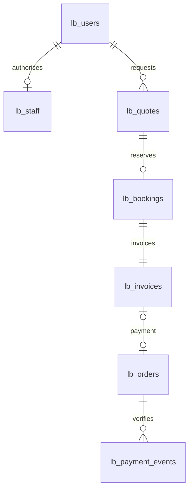

# CR-002 — Align L Beauty with salon appointment delivery

Date: 20 October 2026 (Africa/Johannesburg)
Owner: Tshepo Mohoboko — scope, manual acceptance and defect management
Engineering: Codex — implementation, repeatable checks and release evidence

## Reason and baseline

The catalogue contains treatments. Paying for an item did not reserve staff time.
The previous release proved hosted persistence, login and sandbox payments; it
was not an appointment system. The approved change is a quotation-led service
booking workflow, preserving those working components.

Commerce source/evidence baseline: `5bfa21da86b237a890e5a4c0b3a8c8a584250d19`.
Preserved remote branch: `archive/commerce-sandbox-2026-10-20`.
Previous deployed application: `e1375c99bf351f86548ae4956c6c14252706c149`.
No historical customer, order or payment records are deleted or converted into
appointments. They remain available in the account's previous test orders.

## Release boundary and business flow

Customer: service → quotation request → salon confirms total, duration, buffer
and terms → customer accepts the current quotation → customer selects a time →
appointment and invoice are created atomically → optional sandbox invoice payment
→ verified receipt → salon completes the appointment or records a no-show.

Staff-entered walk-ins use the same capacity checks and create an agreed
quotation, appointment and invoice in one transaction. A guest record belongs to
the staff account that entered it; it never creates or takes over a customer login.

The first release uses one shared salon calendar, one treatment request at a
time, and a total quotation. Additional treatments/removal/design requirements
can be included in notes and confirmed in the quotation. Multi-therapist assignment,
structured add-on line items and bundles are outside this bounded release.

The owner specifically requested quotation → invoice. Consequently every
request receives salon review in this release. Published fixed prices remain
visible; a later approved straight-through path can skip manual quotation for
fully configured treatments.

## Included change

| Area | Result |
| --- | --- |
| Services | Existing 46 services, 11 categories, prices, branding and pictures retained |
| Retail controls | Cart badge, quantity controls and add-to-cart removed from customer flow |
| Legacy routes | `/shop` still opens services; `/cart` explains the appointment flow |
| Legacy checkout API | Returns 410 unless an operator explicitly enables `ENABLE_LEGACY_COMMERCE=1`; absent in hosted configuration |
| Customer account | Existing registration/session flow plus quotation and appointment history |
| Quotation | Versioned amount in ZAR cents, duration, cleanup buffer, terms and seven-day validity |
| Calendar | Configurable hours per weekday, South African time, 15-minute slot starts, 90-day booking horizon |
| Staff | Explicit database-backed staff grants; customers cannot self-assign roles |
| Booking | Atomic reservation and invoice, duplicate submission protection, reschedule and cancellation |
| Capacity | Full treatment plus buffer, shared with walk-ins and blocks; concurrent writes serialized |
| Payments | Existing Stripe sandbox mechanism pays a specific immutable invoice amount |
| Receipt | Appears only after a matching verified paid event; arrival at a return URL is insufficient |
| Cancellation | Voids invoice and releases slot; a late/already-paid payment is flagged for refund review |
| Calendar export | Authenticated `.ics` download for Google Calendar, Outlook and other clients |
| Contact | Dedicated page and visible WhatsApp/call links using existing published contact numbers |
| Audit | Append-only actor, action, entity and timestamp for staff/calendar/booking changes |

## Deliberate operational defaults

Opening hours start disabled with all weekdays closed. The owner enters actual
hours through `/salon`; we do not invent client operating hours. Staff confirms
unknown durations in each quotation. Only four massage durations are supplied in
the existing catalogue. Buffer is explicitly editable, initially suggested as
15 minutes in the staff form. No client deposit percentage, refund policy or tax
registration is invented. Staff must enter the agreed payment and cancellation
terms when issuing each quotation. Online payments remain sandbox-only.

Calendar export is a snapshot. It is not live Google Calendar synchronization,
a private feed, or a source of external busy-time detection. The salon calendar
is authoritative in this release. Live Google sync requires the salon's own OAuth
application/consent and conflict rules; a ChatGPT Google connection does not grant
the deployed website access. External calendar changes do not reserve time here.

Email/SMS reminders, real cash/EFT recording, automatic refunds, multiple staff
calendars, OTP/MFA and password reset are deferred. No delivery-date promise is
made for those items. Customers check their account for quotations and bookings.

## ERD — additions to the retained account/payment model

Booking states: confirmed → cancelled / completed / no_show.
Quotation states: requested → issued → accepted; requested/issued → declined.
Reissuing an unaccepted quote increments its revision. A stale acceptance fails.
Accepted quotations and invoice totals are immutable.
Payment states are independent of appointment states: unpaid/pending/paid,
expired/failed, or refund_required following a paid cancellation.

## Migration and rollback

`backend/migrations/002_service_bookings.sql` adds seven tables and supporting
indexes. It seeds a closed calendar and schema version 2. Apply first to the
existing isolated Neon Preview branch, verify schema and existing data, then apply
to Production before releasing the application. No secrets change is needed.

Rollback: deploy the preserved commerce runtime SHA; schema 2 is additive and can
remain. New booking tables are preserved for investigation. Do not reset the
database or reinterpret existing purchases as appointments. Existing commerce
checks remain available at the archive branch, with their evidence.

## Acceptance and QA ownership

Automated checks cover normal and negative API/browser cases. Tshepo performs
client acceptance using the published UI and records actual versus expected
results. A green automated build is engineering evidence, not client sign-off.

| ID | Requirement / expected result | Evidence |
| --- | --- | --- |
| BK-01 | Request persists, duplicates create one request | API + browser |
| BK-02 | Customer cannot issue quote or access staff calendar | API + browser |
| BK-03 | Revised/expired/unaccepted quotation cannot be booked | API |
| BK-04 | Two concurrent customers cannot book overlapping intervals | SQLite + Postgres |
| BK-05 | Treatment and cleanup both fit opening hours | API |
| BK-06 | Walk-in and unavailable block remove online capacity | API |
| BK-07 | Booking and invoice are created once together | API + browser |
| BK-08 | Rescheduling preserves invoice and rechecks capacity | API + browser |
| BK-09 | Cancellation releases slot and voids invoice | API + browser |
| BK-10 | Another customer cannot read/change records or calendar export | API |
| BK-11 | Invoice uses quoted amount; receipt requires verified paid event | API |
| BK-12 | Payment after cancellation requires refund review; booking stays cancelled | API |
| BK-13 | Existing login refresh/logout/relogin still works | API + browser |
| BK-14 | All service images/prices/categories retained; narrow layouts usable | Browser |
| BK-15 | Actual client hours, duration and policies approved | Tshepo/client manual acceptance |

## External workflow evidence

These are observed examples, not a claim about every therapist:

- Pretoria Fresha listings separate removal from overlays/fills and assign service
  durations. Siphiwe Jiyane lists a 15-minute removal and a 75-minute gel overlay.
  https://www.fresha.com/lp/en/tt/gel-nails/in/za-pretoria
- Mira Salon's booking menu varies acrylic duration by length and explicitly asks
  customers to add nail art to allocate enough time. Simple/medium/complex art
  each have their own duration and price.
  https://book.gettimely.com/Booking/Location/280394?mobile=True
- Deposit/payment policies vary across operators. They must be the salon's own
  agreement; we do not copy a competitor's percentage or claim all salons require
  a formal quotation.
