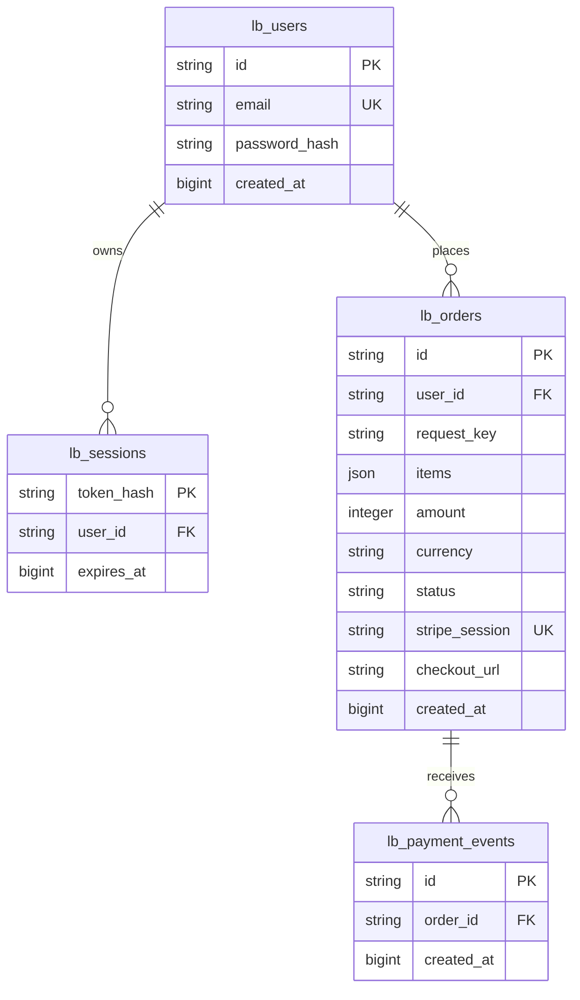
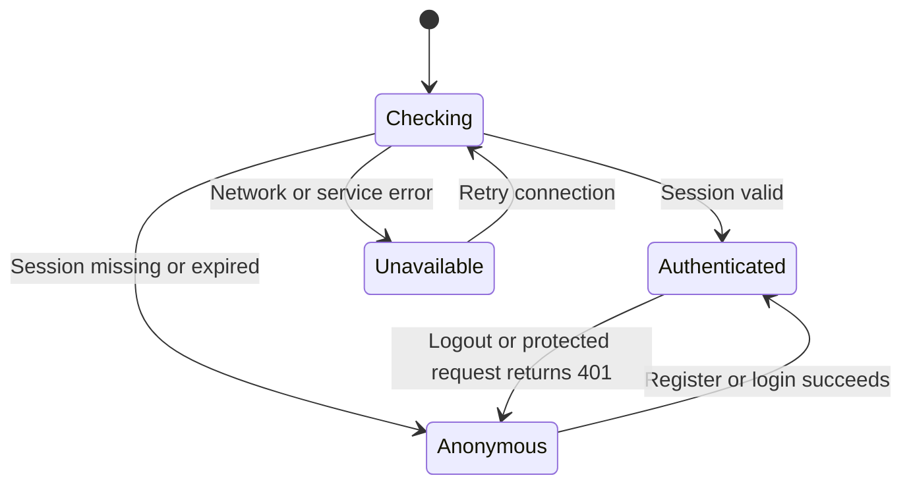
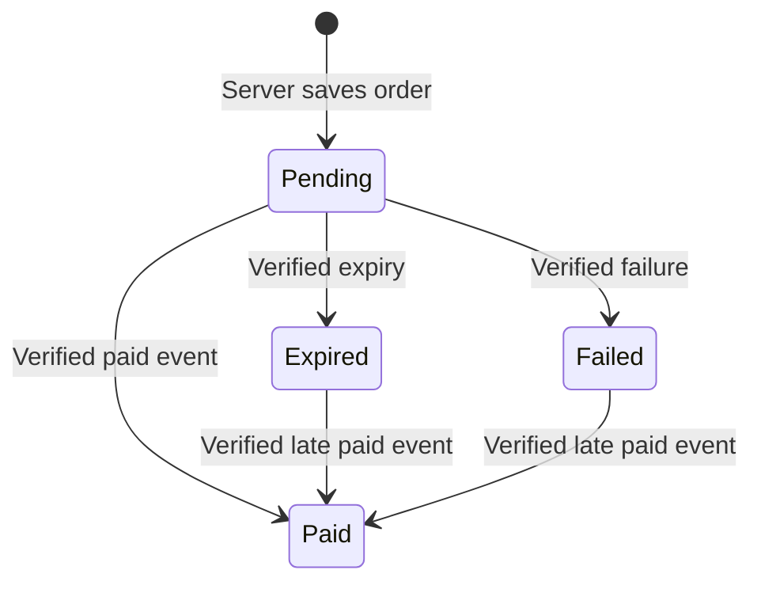
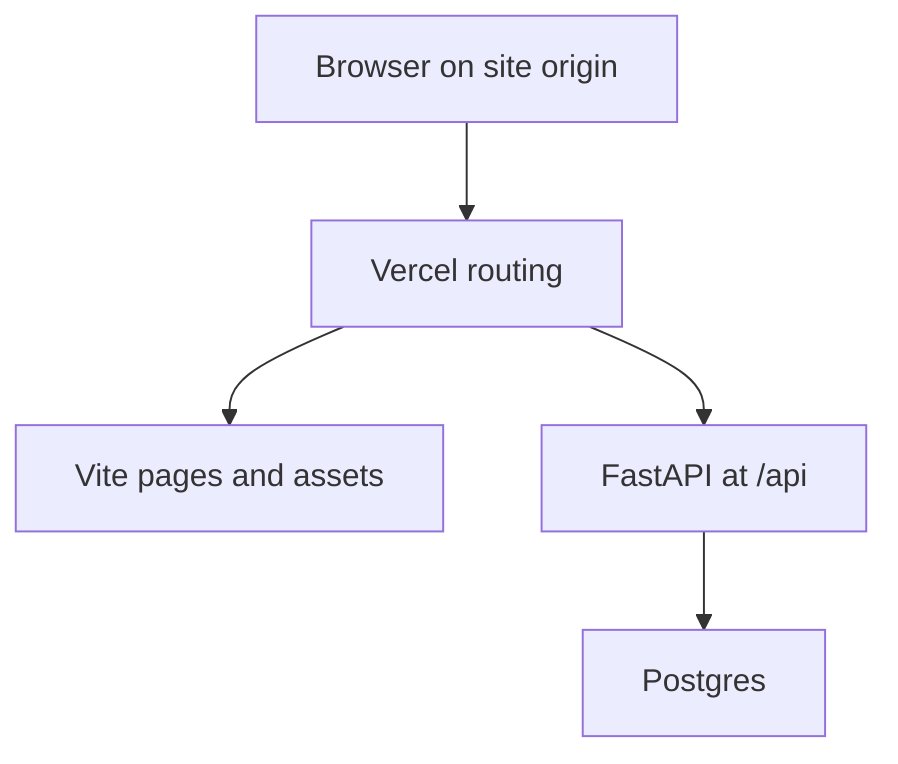

# L Beauty — persistence, entities and browser state

Status: implemented model on `feat/hosted-login-stripe`; hosted database provisioning is pending account connection. The user accepted the header login action and login/register UI on 2026-10-20. This document records the implementation, not a claim that hosted database acceptance has passed.

## Entity relationship diagram

Source of truth: `backend/app/db.py`. Names below are actual table names.

`(user_id, request_key)` is unique per checkout attempt. Amounts are integer minor units (cents), not floating-point money. `items` is an immutable JSON snapshot of service ID, name, quantity and unit price; it is not a separate order-items table. It preserves the charged details when catalogue copy later changes. Service identities/prices remain in the version-controlled 46-service catalogue, mirrored to server JSON and checked in CI. No fictitious product/category database entities are shown here.

Two supporting tables are separate from customer relationships: `lb_rate_limits` stores hashed request-bucket keys, counts and expiry; `lb_schema` tracks schema version 1. No raw session tokens, passwords, card numbers or complete Stripe event payloads are stored in these tables.

## Where state belongs

| State | Owner and storage | Recovery / acceptance |
|---|---|---|
| Customer identity and password hash | Postgres `lb_users` | New API process still finds the same account |
| Login session | HttpOnly cookie in browser; only token hash + expiry in Postgres | Refresh/restart restores valid session; logout revokes it |
| Visible account state | React session hook | Explicit checking, anonymous, authenticated and unavailable states |
| Bag before checkout | Browser localStorage `moya-cart`, best effort | Refresh in the same browser preserves bag; cross-device cart sync is not implemented |
| Search/category selection | React memory | Reset on a fresh page load |
| Order amount and service snapshot | Postgres `lb_orders` | Server ignores client prices; customer only sees own orders |
| Checkout redirect and attempt marker | Order row + temporary browser state | Stripe idempotency key is tied to durable order ID |
| Payment confirmation | Verified Stripe event + Postgres transaction | Redirect alone never confirms payment; duplicate events have no duplicate effect |

The React session hook aborts an older session request when a newer login/logout result arrives. A 503/network error is unavailable, not anonymous. Account submit and checkout remain disabled during checking/unavailability, with a retry action. A 401 on protected order/checkout operations returns the UI to the anonymous state.

Form submission also has a local busy/error state. That does not change the authoritative session until the server returns success.

Paid is never downgraded by a late expiry/failure event. Each event ID is unique. Postgres locks the order row and commits payment state and event acknowledgement together. Pending orders survive provider/network failures and retry with the same Stripe idempotency key.

## Browser origin and cookies

Production and preview routing use one public origin per deployment:

All frontend API paths are relative `/api/...` and requests use `credentials: same-origin`. Vercel Services routes the original `/api` path to FastAPI. It is currently a beta platform feature. There is no browser request to a separate backend domain, so a cross-origin CORS allowlist is unnecessary for this deployment. No wildcard credentialed CORS policy is installed.

The backend separately checks the Origin of unsafe browser requests against the site origin. This is CSRF protection, not a substitute name for CORS. A hostile-origin logout returns 403 without revoking the cookie's session. Foreign preflight requests are not granted CORS response headers. Cookies are HttpOnly, SameSite=Lax, path=/, Secure under HTTPS/Vercel, with an eight-hour lifetime. No browser JavaScript receives the raw token from the API body.

Local Vite uses an explicit proxy preserving the original Host (`changeOrigin:false`) so the same-origin check behaves like deployment. That proxy setting corrected the previously detected local Origin mismatch.

Stripe's webhook is a server-to-server request, so browser CORS does not apply. It is exempt from browser Origin checking and instead requires the real Stripe signature over the exact request bytes. Preview Vercel Authentication blocks unauthenticated Stripe requests before application code; initial hosted payment acceptance therefore targets the public production webhook after promotion. Preview UI/login verification can use the authorized preview session.

## Storage lifecycle and verification

- Hosted runtime requires `DATABASE_URL` or `POSTGRES_URL` pointing at Postgres. No local or in-memory fallback is allowed on Vercel.
- Local development/test may use SQLite. Foreign keys are enabled there too, keeping relationship enforcement consistent with Postgres.
- Connection creation is lazy; missing configuration does not break the catalogue build. Schema version 1 uses additive table creation and a Postgres advisory lock to serialize first initialization. It never drops/recreates hosted data. Future changes require versioned migrations.
- CI runs a real Postgres 16 service plus SQLite. New persistence checks spawn a fresh Python API process against the same database and restore a previously issued session. Tests also cover foreign keys, HTTPS cookies, hostile logout and preflight denial.
- Existing tests cover customer ownership, price validation, duplicate/concurrent checkout and webhook handling. Frontend checks cover loading/unavailable/retry states as well as the accepted login flow.

Release gate: database connected → deployed readiness reports database=true → customer account survives refresh/restart → Stripe sandbox key and public webhook configured → genuine sandbox checkout confirms the order. These checks are engineering-owned. Manual QA owns scenario acceptance, scope and defect priority.
