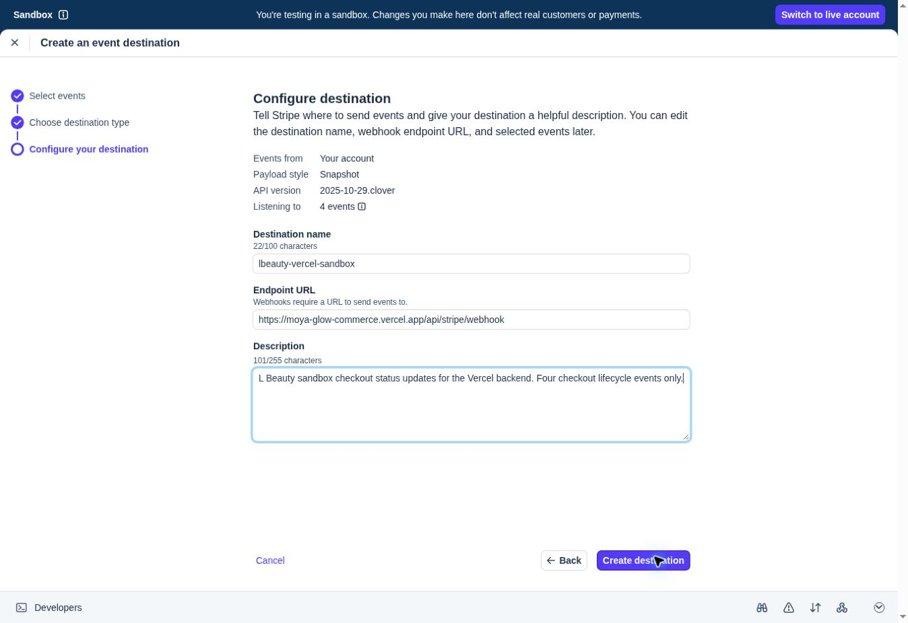

# Hosted backend handoff — 20 October 2026

## Confirmed

- Neon Free project `lbeauty-commerce` has separate preview and production branches with schema v1 applied. See [storage record](../docs/DEPLOYED_STORAGE.md).
- Runtime commit `aa21fcb` passed 23 Chromium regressions and 35 real Postgres 16 backend checks in [CI run 39373453506](https://github.com/tmohoboko/moya-glow-commerce/actions/runs/39373453506).
- Stripe Google sign-in completed. A fresh dashboard inspection confirmed access to **Bee app sandbox**, account `acct_1SQT0NQ1B6QZy9gL`, with the explicit Sandbox banner. No live mode changes or payments were made.
- Prepared, but did not submit, the webhook destination `lbeauty-vercel-sandbox` at `https://moya-glow-commerce.vercel.app/api/stripe/webhook` using snapshot payloads and API version `2025-10-29.clover`.
- Selected exactly four events: `checkout.session.completed`, `checkout.session.expired`, `checkout.session.async_payment_succeeded`, and `checkout.session.async_payment_failed`.

## Blocked and pending

Automatic approval review rejected a second attempt to store the Preview Neon connection as a server-only sensitive `DATABASE_URL` in Vercel project `moya-glow-commerce`, because it requires explicit authorization for that specific credential transfer. The Production write was not attempted. No browser, CLI, or other workaround was used. No new deployment was made without its database configuration.

The concrete remaining approval is permission to store each Neon branch credential in the matching Vercel environment and to connect the Stripe sandbox to that same project using private `STRIPE_SECRET_KEY` and `STRIPE_WEBHOOK_SECRET` values. Stripe credentials have not been revealed or copied. The prepared webhook has not been created.

## Execution after authorization

1. Save isolated Preview and Production database secrets, scoped to the intended environment/feature branch.
2. Deploy Preview and verify database connectivity, registration, login, refresh/session restoration, logout/revocation, ownership and origin rejection.
3. Submit the prepared sandbox webhook, securely bind the test API key and signing secret to Vercel, and stage a production build.
4. Verify public endpoint readiness and sandbox success, cancellation, decline, authentication challenge, signed webhook delivery and persisted order history before acceptance.
5. Record the deployment IDs and evidence; leave manual acceptance to the account owner.

No hosted login or genuine Stripe sandbox checkout has yet been claimed as passing.
