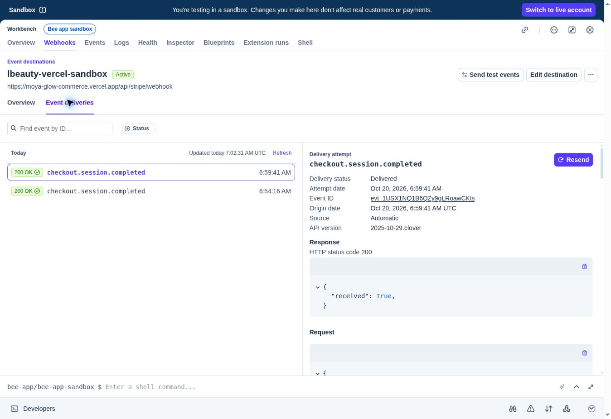

# L Beauty hosted backend acceptance — 20 October 2026

**Ready for the owner's manual sandbox testing.** Authentication and persistent order storage are deployed at [moya-glow-commerce.vercel.app/account](https://moya-glow-commerce.vercel.app/account). No real payments are enabled.

## Deployed build

| Item | Evidence |
|---|---|
| Runtime commit | `e1375c99bf351f86548ae4956c6c14252706c149` |
| Production deployment | `dpl_31VSY3bwMeZXfm735boJSmsUorCC` — READY |
| Unique deployment | `https://moya-glow-commerce-pansfqixo-tmdev.vercel.app` |
| Public home, API health and readiness | HTTP 200; database=true, stripe=true, payment_mode=test |
| Storage | Neon Postgres 16, schema v1; separate Preview and Production branches |
| Secret scope | Private DATABASE_URL per environment; private Stripe sandbox API/signing secrets in Production only |
| Stripe destination | `lbeauty-vercel-sandbox`, `we_1USW30Q1B6QZy9gLlf6neaCi` |
| Stripe account | Bee app sandbox, `acct_1SQT0NQ1B6QZy9gL` |
| API / webhook version | `2025-10-29.clover` |

## Automated and hosted verification

| Verification | Result | Evidence |
|---|---|---|
| Hosted Chromium UI regression | 23 passed | [CI run 39382935840](https://github.com/tmohoboko/moya-glow-commerce/actions/runs/39382935840), latest hosted job `118497034638` |
| Local Chromium regression in CI | 23 passed | Same run, regression job |
| SQLite backend | 34 passed, 1 Postgres-only skipped | Same run, backend job `118497085192` |
| Dedicated Postgres 16 backend | 35 passed | Same backend job; includes concurrent checkout/webhook and database session restoration |
| Public HTTPS API acceptance | 29 checks passed | [hosted-api-results.json](hosted-api-results.json) |
| Payment history after browser checkout | Fresh login and persisted orders passed | [hosted-payment-results.json](hosted-payment-results.json) |
| Independent deployed database read | Two paid orders, exactly one recorded verified event per paid order | [hosted-sql-results.json](hosted-sql-results.json) |

The public API checks cover registration, fresh-client session restoration, Secure/HttpOnly/SameSite cookies, no-store responses, failed login, logout token revocation, blocked hostile-origin logout, absent foreign credentialed CORS grants, order ownership, price injection rejection, unsigned webhook rejection and checkout idempotency. The catalogue remains 46 services across 11 categories.

## Genuine Stripe sandbox cases

| Case | Expected and observed result |
|---|---|
| Success — test card ending 4242 | Stripe-hosted R450 checkout completed; order `93c7352d-ccf7-4fbe-a98b-da630c48180f` is paid |
| Cancellation | Stripe Back link returned to the site's Checkout cancelled page; order `08e864eb-5d99-4c74-8eef-cfc66fded19f` remains unpaid/pending |
| Decline — test card ending 0002 | Stripe displayed a card-declined error; order `0c69c3ec-fc0a-4d64-ab61-ac9cfccc3ad6` remains unpaid/pending |
| 3D Secure — test card ending 3155 | Stripe displayed the test authentication challenge; COMPLETE succeeded; order `3d2a2607-2818-41be-9cff-4c33f614ff70` is paid |
| Webhooks | Two checkout.session.completed deliveries returned HTTP 200 and received=true; each matching paid order has one persisted event |

A cancelled or declined open Checkout Session can still be retried; it remains pending until a later verified payment or expiry event. Browser redirects alone never mark an order paid. These browser payment sessions were created by the API test client, so that separate browser had no customer session on return; payment persistence was verified through the authenticated API and independent SQL. The hosted Chromium account tests separately verify browser registration, reload, login and logout.

[Decline screenshot](stripe-decline.jpg) · [3D Secure challenge screenshot](stripe-3ds-challenge.jpg)

## Defects fixed during hosted verification

- Stripe Python 16 defaulted to 2026-09-30.endive, which rejects this integration's payment_method_types parameter. Requests now explicitly match the existing webhook's Clover version; an SDK transport regression asserts the version header and card-only payload. See [Stripe's explanation](https://support.stripe.com/questions/fix-the-payment-method-types-error).
- The public home path returned a platform 404 while deep links worked. An explicit root route now selects the frontend index. The first hosted run preceded deployment readiness; only the affected hosted job was rerun after the root returned 200, and all 23 tests passed.

## Manual acceptance for the owner

1. Open the public account page and choose **New here? Create an account**. Use an email and a password of at least 12 characters.
2. Refresh, log out, and log back in. Confirm the account and order history behave as expected.
3. Add **Full Body — R450** to the bag and choose **Continue to Stripe test checkout**.
4. Use Stripe's public test card **4242 4242 4242 4242**, expiry **12/34**, CVC **123**, and a test cardholder name. Confirm the Sandbox label and R450 amount before submitting.
5. Confirm **Test payment confirmed** and the paid order in My account. Record any defect with steps, expected/actual behaviour and a screenshot.

## Operational boundaries

- Live keys and live events are rejected. This release does not activate real payments.
- Preview remains protected and has only its isolated database credential; it is not the payment test endpoint.
- The Vercel project has no connected Git integration. Releases use the existing authenticated Vercel deployment connector; CI runs tests automatically. Runtime commit and deployment ID above identify the exact tested build.
- Runtime-log API access returned a provider 403; no clean-log claim is made. Stripe dashboard responses, public API checks, hosted browser tests and database evidence supplied the functional verification.
- No password reset, email verification, public admin role, booking reservation or cross-device cart synchronisation is included. The owner retains manual business acceptance.

Artificial test credentials and checkout links are excluded from source and this evidence bundle. Reuse `scripts/verify-hosted.py` for bounded API acceptance; it keeps its temporary account credentials outside the repository.
